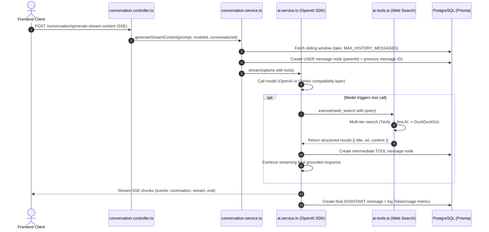

# MKK AI Agent - Backend Architecture & Coding Skill

This skill provides the standalone architectural blueprint, directory structure, and development runbooks for the **MKK AI Agent Backend** repository (Express.js v5, TypeScript, Prisma ORM, PostgreSQL).

---

## 📁 Backend Directory Structure

```text
backend/
├── prisma/
│   ├── migrations/                  # Committed SQL migrations
│   ├── models/                      # Modular Prisma schema definitions (1 model per file)
│   │   ├── apiTokens.prisma         # Encrypted user provider API keys (AES-256)
│   │   ├── conversationMessages.prisma # Message tree nodes with parentId chaining
│   │   ├── conversations.prisma     # Conversation sessions/threads
│   │   ├── models.prisma            # Catalog of active/inactive AI models
│   │   ├── providers.prisma         # AI Providers (Gemini, OpenAI, etc.)
│   │   ├── refreshToken.prisma      # JWT refresh tokens
│   │   ├── session.prisma           # Active user sessions
│   │   ├── tokenUsage.prisma        # Per-turn token consumption metrics
│   │   └── user.prisma              # User accounts & roles (USER, ADMIN)
│   ├── schema.prisma                # Datasource & client generator configuration
│   ├── seed.ts                      # Admin user creation & Gemini model discovery seed
│   └── conversationSeed.ts          # Sample conversation data seed
├── src/
│   ├── config/
│   │   ├── env.ts                   # Zod-validated environment configuration (TAVILY_API_KEY optional)
│   │   └── prisma.ts                # PrismaClient singleton instance
│   ├── controllers/                 # Express request handlers (wrapped in asyncHandler)
│   │   ├── auth.controller.ts       # Registration, login, logout, verification, password reset
│   │   ├── conversation.controller.ts # Streaming generation, retries, list, delete
│   │   ├── provider.controller.ts   # Provider listing & update
│   │   ├── apiToken.controller.ts   # User-encrypted API token CRUD
│   │   └── user.controller.ts       # User profiles & admin user management
│   ├── middlewares/
│   │   ├── auth.middleware.ts       # JWT verification (sets req.user)
│   │   ├── admin.middleware.ts      # Enforces ADMIN role guard
│   │   ├── error.middleware.ts      # Global centralized error formatting
│   │   └── validate.middleware.ts   # Zod request body/query validation
│   ├── modules/                     # Zod request validation schemas (*.schema.ts)
│   ├── routes/                      # Route mappers
│   │   ├── auth.route.ts            # /auth routes
│   │   ├── conversation.route.ts    # /conversation routes
│   │   ├── provider.route.ts        # /provider routes
│   │   ├── token.route.ts           # /api-token routes
│   │   ├── user.route.ts            # /user routes
│   │   └── index.ts                 # Master router mounting all sub-routes
│   ├── services/                    # Business logic & database operations
│   │   ├── ai.service.ts            # Unified OpenAI/Gemini completion & streaming engine
│   │   ├── conversation.service.ts  # History resolution, sliding window, tree branching
│   │   ├── provider.service.ts      # Model discovery & provider synchronization
│   │   ├── apiToken.service.ts      # AES-256 token encryption & decryption
│   │   ├── auth.service.ts          # Password hashing, mail verification & JWT lifecycle
│   │   └── user.service.ts          # User queries & profile updates
│   ├── types/
│   │   └── ai.types.ts              # GenerateOptions, GenerateResult, ToolDefinition
│   ├── utils/
│   │   ├── ai-tools.ts              # Multi-tier Autonomous Web Search (Tavily/Jina/DuckDuckGo)
│   │   ├── cryptoUtils.ts           # AES-256 encryption/decryption helpers
│   │   ├── gemini.ts                # Native @google/genai utility
│   │   ├── api-error.ts             # Standardized ApiError class
│   │   ├── api-response.ts          # Standardized ApiResponse class
│   │   ├── async-handler.ts         # Express async route wrapper
│   │   ├── jwt.ts                   # JWT sign & verify utilities
│   │   ├── logger.ts                # Winston structured logger
│   │   ├── mail.ts                  # Nodemailer verification sender
│   │   └── password.ts              # bcrypt password hashing & verification
│   ├── app.ts                       # Express app configuration (CORS, Helmet, RateLimiter)
│   └── server.ts                    # Server listener startup script
├── tests/                           # Jest test suites
├── .env.example                     # Environment template file
├── jest.config.ts                   # Jest ts-jest configuration
├── tsconfig.json                    # Production build config (excludes tests)
└── tsconfig.test.json               # Test typecheck config (noEmit: true)
```

---

## 🔄 Backend Execution Flow



---

## 🤖 AI Engine & Tool Calling Rules

1. **Unified Multi-Provider Engine (`AiService`)**:
   - Both OpenAI models and Google Gemini are executed via the `openai` SDK client.
   - For Gemini, `baseUrl` is configured to `https://generativelanguage.googleapis.com/v1beta/openai/`.
   - **Tool Calling Schema Rule**: Tools MUST always be registered using `type: "function"`:
     ```typescript
     toolList.push({
       type: "function",
       function: {
         name: aiTools.webSearchTool.name,
         description: aiTools.webSearchTool.description,
         parameters: aiTools.webSearchTool.parameters,
       },
     });
     ```
   - **Never** pass unsupported string types (e.g. `type: "web_search"`).

2. **Autonomous Web Search Tool (`src/utils/ai-tools.ts`)**:
   - Tier 1: Tavily API (used if `env.TAVILY_API_KEY` is provided).
   - Tier 2: Jina AI Search API (`https://s.jina.ai/{query}`, free, no API key required).
   - Tier 3: DuckDuckGo HTML scraper fallback.
   - **Rule**: Web search must never throw an unhandled error due to missing API keys.

---

## 🧠 Memory & Tree Branching Architecture

1. **Sliding Context Window**:
   - `conversation.service.ts` pulls the most recent `MAX_HISTORY_MESSAGES` active turns to keep prompt tokens within model limits.
2. **Relational Tree Structure (`conversation_messages`)**:
   - Every message stores `parentId` referencing the previous turn.
   - **Prompt Edits**: Editing a past user prompt creates a new child node branching from the ancestor `parentId`, preserving prior branches.
   - **Retries**: Retrying an assistant turn deletes/inactivates the draft and creates a new sibling turn under the original user prompt.
3. **Trace Memory**:
   - Intermediate `TOOL` records store `toolCalls` JSON for full execution auditability.
4. **Token Usage Metrics**:
   - Each assistant turn records `promptTokens`, `completionTokens`, and `totalTokens` in `TokenUsage`.

---

## ⚙️ Development & Verification Runbook

### Node Environment
```bash
export PATH="/home/mkk/.nvm/versions/node/$(ls /home/mkk/.nvm/versions/node 2>/dev/null | tail -n 1)/bin:$PATH"
```

### Essential Commands
```bash
# Verify TypeScript without emitting files
npx tsc --noEmit

# Run development server
npm run dev

# Prisma schema generation & migration
npm run prisma:generate
npm run prisma:migrate
npx tsx prisma/seed.ts

# Run tests
npm test
```

---

## ⚠️ Critical Rules & Pitfalls to Avoid

- **No Output Files in `tests/`**: Always keep `"noEmit": true` in `tsconfig.test.json`. Never let `tsc` compile `.js`, `.js.map`, or `.d.ts` files inside `tests/`.
- **Async Handling**: Every controller method must be wrapped in `asyncHandler` (`src/utils/async-handler.ts`).
- **Input Validation**: Validate all incoming request payloads via Zod schemas in `src/modules/`.
- **Safe Keys**: All user-provided API tokens must be encrypted using `encryption()` before storing in database.
