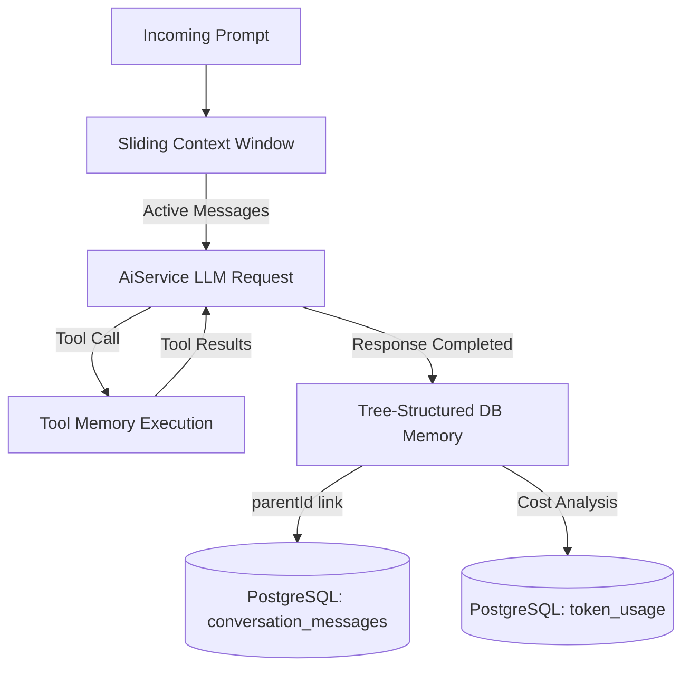

# MKK AI Agent - Backend

High-performance TypeScript backend API for the MKK AI Agent platform. Built with Express.js v5, Prisma ORM, and PostgreSQL, supporting multi-provider AI completions (OpenAI, Gemini), tool execution (Web Search), and conversation tree management.

---

## 🛠️ Tech Stack

- **Runtime & Framework**: Node.js, TypeScript, Express.js 5.2
- **Database & ORM**: PostgreSQL, Prisma ORM 7.10 (modular schemas)
- **AI SDKs & Providers**: `openai` (Chat Completions & compatible endpoints)
- **Security & Auth**: JWT (HttpOnly Cookies), bcrypt, AES encryption (`cryptoUtils`), Helmet, CORS, Rate Limiting
- **Validation & Tools**: Zod, Winston logger, Nodemailer
- **Testing**: Jest, Supertest, ts-jest

---

## 📁 Directory Structure

```text
backend/
├── prisma/
│   ├── models/                  # Modular Prisma schema definitions
│   │   ├── apiTokens.prisma     # Encrypted user provider API keys
│   │   ├── conversationMessages.prisma # Message nodes (tree structure)
│   │   ├── conversations.prisma # Chat sessions/threads
│   │   ├── models.prisma        # Available AI models
│   │   ├── providers.prisma     # AI Providers (Gemini, OpenAI, etc.)
│   │   ├── refreshToken.prisma  # JWT refresh tokens
│   │   ├── session.prisma       # Active user sessions
│   │   ├── tokenUsage.prisma    # Token tracking per message
│   │   └── user.prisma          # User accounts & roles
│   ├── schema.prisma            # Datasource & generator config
│   ├── seed.ts                  # Admin user & model discovery seed
│   └── conversationSeed.ts      # Seed sample conversation data
├── src/
│   ├── config/                  # Environment (env.ts) and Prisma client (prisma.ts)
│   ├── controllers/             # Auth, User, Conversation, Provider, Token handlers
│   ├── middlewares/             # Auth, Admin, Validation, and Error middlewares
│   ├── modules/                 # Zod validation schemas
│   ├── routes/                  # Express route definitions
│   ├── services/
│   │   ├── ai.service.ts        # Unified OpenAI/Gemini completion & streaming engine
│   │   ├── apiToken.service.ts  # Encrypted API key management
│   │   ├── auth.service.ts      # Auth logic, JWT tokens, and mail verification
│   │   ├── conversation.service.ts # Chat lifecycle & history orchestration
│   │   ├── provider.service.ts  # Provider & model catalogue management
│   │   └── user.service.ts      # User profile & administrative operations
│   ├── types/                   # TypeScript interfaces (ai.types.ts)
│   ├── utils/                   # Helpers (ai-tools, crypto, jwt, logger, mail)
│   ├── app.ts                   # Express app configuration & middleware pipeline
│   └── server.ts                # Server bootstrapper & listener
├── tests/                       # Jest test suites
├── .env.example                 # Environment variables template
├── jest.config.ts               # Test configuration
├── tsconfig.json                # Production TypeScript config
└── tsconfig.test.json           # Test TypeScript config
```

---

## 🤖 Core Agent Capabilities

The backend architecture includes:
- 🌐 **Autonomous Web Search**: Multi-tiered search pipeline (Tavily, Jina AI, DuckDuckGo) with zero mandatory configuration.
- ⚡ **Real-Time Streaming SSE**: Incremental token delivery and streaming tool call resolution.
- 🤖 **Multi-Provider Orchestration**: Unified abstraction over OpenAI and Google Gemini models.
- 🧠 **Context & Tree Memory**: Sliding window context pruning with parent-child message branching.
- 🪙 **Token Metering**: Accurate turn-by-turn token accounting (`token_usage`).
- 🔐 **Cryptographic Security**: AES-256 encrypted isolation for user API credentials.

---

## 🧠 Agent Memory Base Architecture

The agent's memory is structured into three layers to balance latency, token limits, and historical context:



### 1. Sliding Window Context (Short-Term Memory)
- **Token Efficiency**: Pulls the most recent `MAX_HISTORY_MESSAGES` (active status) from database order by `createdAt: desc`.
- **Role Normalization**: Formats past messages into `{ role, content }` tuples (`system`, `user`, `assistant`, `tool`) before passing them to the model context.

### 2. Relational Tree Structure (Long-Term Memory)
- **Message Chaining**: Every message in `conversation_messages` has an optional self-referencing `parentId` pointing to its ancestor.
- **Branching, Retries & Edits**:
  - Editing a past user prompt creates a new child node under that prompt's `parentId`, preserving prior conversation turns without destructive overwrites.
  - Retrying an assistant response deletes/inactivates the failed draft and regenerates a fresh sibling response linked to the original user turn.

### 3. Tool Execution Memory
- Tool invocations (`toolCalls` JSON) and returned data are saved as intermediate `TOOL` and `ASSISTANT` records in the database.
- Provides traceability for external lookups (e.g. search queries and results) across multiple conversation turns.

### 4. Encrypted Provider Credentials Memory
- User-provided API keys are AES-256 encrypted (`cryptoUtils.ts`) and loaded per provider request, with automatic fallback to platform environment keys.

---

## 🔄 Core Workflows

### 1. Chat Completion & Streaming Workflow
1. **Client Request**: `POST /conversation/generate-stream-content` with prompt, model ID, and optional conversation ID.
2. **Context Resolution**: Retrieves conversation thread and sliding window history.
3. **Provider Initialization**: `AiService` decrypts active API key, configures model credentials, and mounts tools (`web_search`).
4. **Execution & Tool Loop**:
   - Model generates stream chunks or triggers tool calling.
   - If `web_search` is triggered: executes Tavily (if configured) or free fallback (Jina AI / DuckDuckGo), returns tool output back to model loop.
5. **Stream Delivery**: Pushes Server-Sent Events (`coversation`, `stream`, `error`, `end`) to client.
6. **Persistence**: Saves assistant reply, tool payload, and `token_usage` metrics.

### 2. Model & Provider Management Workflow
1. Admin seeds models via `npx tsx prisma/seed.ts` or updates provider configuration.
2. Users configure custom tokens via `/api-token` routes.
3. Tokens are verified via lightweight health checks before becoming `ACTIVE`.

---

## 🚀 Getting Started

### Prerequisites
- Node.js v18+
- PostgreSQL 14+

### Setup

```bash
# 1. Install dependencies
npm install

# 2. Configure environment
cp .env.example .env
# Update DATABASE_URL, JWT secrets, ENCRYPTION_KEY, etc.

# 3. Apply Prisma migrations & seed database
npm run prisma:migrate
npx tsx prisma/seed.ts

# 4. Start development server
npm run dev

# 5. Build for production
npm run build
npm start
```

### Initial Admin & Provider Configuration

Once setup and database seeding are complete:
1. Log in with the admin account (seeded default: `admin@gmail.com` / `Admin@123`).
2. Go to the **Admin Dashboard > Providers** page in the frontend UI.
3. Configure your **Gemini** and **OpenAI** API keys.
4. Migrate/sync available models from providers.
5. Update provider and model statuses (`ACTIVE` / `INACTIVE`) as needed.

---

## 📡 API Endpoints Overview

| Route Group | Base Path | Key Endpoints | Description |
| :--- | :--- | :--- | :--- |
| **Auth** | `/auth` | `POST /register`, `/login`, `/logout`, `/verify-mail`, `/refresh-token` | User authentication & sessions |
| **User** | `/user` | `GET /profile`, `PUT /profile`, `PUT /change-password`, `GET /list` (Admin) | Profile management & admin controls |
| **Conversation** | `/conversation` | `POST /generate-stream-content`, `POST /retry-stream-content`, `GET /list`, `DELETE /:id` | Chat streaming & thread management |
| **Provider** | `/provider` | `GET /list`, `PUT /:id` | AI providers & model listing |
| **API Tokens** | `/api-token` | `POST /create`, `GET /list`, `DELETE /:id` | Encrypted user provider API keys |
